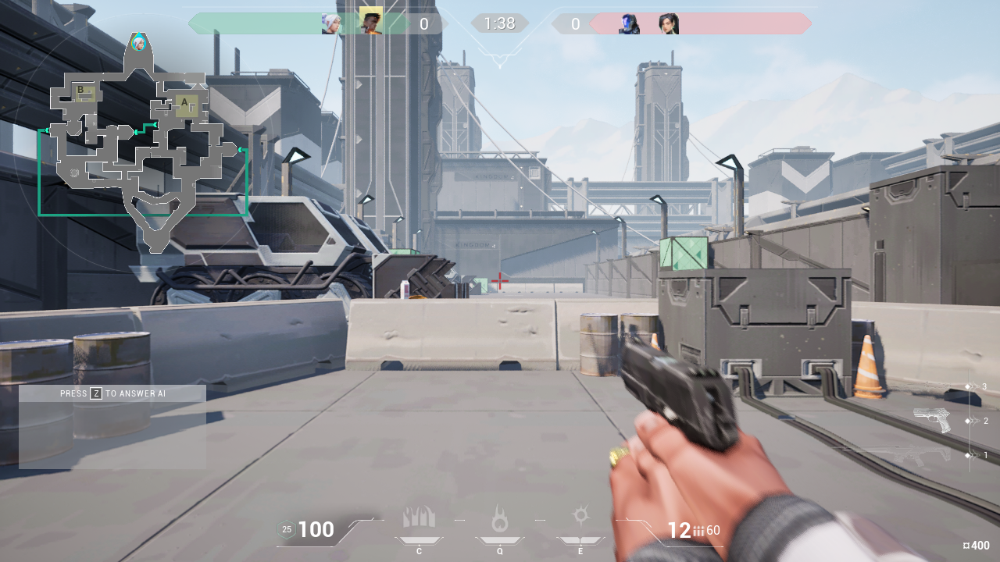

# UI Architecture & Multiplayer Stability

UE 5.5 VALORANT 팀 프로젝트에 수행한 개인 후속 리팩터링이다. 기존 팀의 매치·GAS·무기·스파이크와 UMG 자산을 바탕으로 상점의 화면 수명, 구매 정합성, HUD 상태 전달을 개선했다. 팀 프로젝트 기여와 시연은 [기존 README](../../README.md)에 있다.

## 화면과 데이터

기존 상점 위젯이 구매 판정·복제 구독·입력 모드를 함께 관리하던 구조에서 화면·서버·표시 상태의 수명을 구분했다.

~~~mermaid
flowchart TD
    PC[AgentPlayerController] --> Layer[ShopLayer / CommonUI Stack]
    Layer --> Screen[ShopScreen / authored Shop WBP]
    Layer --> Modal[ShopConfirmation / WBP_ShopConfirmation]
    Input[CommonUI Input Data / DT_UIInputActions] -.-> Screen
    Input -.-> Modal
    Screen --> ShopVM[ShopViewModel / FieldNotify]
    Modal --> ShopVM
    ShopVM --> RPC[Server purchase RPC]
    RPC --> Shop[ShopComponent]
    Shop --> Credit[CreditComponent]
    Shop --> Agent[BaseAgent / weapon slots]
    Credit --> Combat[CombatHUDViewModel]
    Agent --> Combat
    PS[PlayerState / ability stacks] --> Abilities[HUDAbilityBarModel]
    Combat --> HUD[MatchMapHUD / Blueprint presentation]
    Abilities --> HUD
    GS[MatchGameState] --> Top[MatchMapHudTopWidget]
~~~

UShopLayer가 Activatable Stack을 소유한다. UShopScreen은 기존 WBP_MatchMap_ShopUI를 담고 상품 버튼 그룹과 카테고리 이동을 관리한다. 모달에서 취소하면 CommonUI가 저장한 포커스로 선택한 상품에 돌아온다. 기본 상점 그리드·아이콘·충전 바를 재사용했다. 상시 HUD는 게임 조작 중 상태를 보여 주는 UMG 화면으로 유지했다.

UShopViewModel은 잔액, 선택, 구매 대기와 결과를 FieldNotify로 전달한다. 구현은 UMVVMViewModelBase의 네이티브 구독이며 UMG 에디터의 MVVM View Binding은 미적용이다. 화면을 닫으면 선택과 피드백을 지우고 서버 처리 중인 요청은 계속 추적한다. 타임아웃은 대기를 해제하고 결과 미확인을 알린다. 늦게 복제된 장비와 재화는 실제 값에 따라 갱신된다.

## 입력 액션

상점 화면 코드에는 키 판정이 없다. 뒤로 가기·상점 키·카테고리 이동·모달 확인은 CommonUI 액션으로 처리한다.

- **입력 데이터.** DT_UIInputActions(CommonInputActionDataBase)에 Confirm(Enter / A), Back(Esc / B), ShopClose(B / View), ShopPreviousCategory(LB), ShopNextCategory(RB) 행을 둔다. BP_UIInputData가 Default Click=Confirm, Default Back=Back을 지정하고 DefaultGame.ini의 CommonInputSettings가 이 Input Data를 가리킨다.
- **상점 화면.** UShopScreen은 bIsBackHandler로 Default Back을 받아 닫힌다. 상점 키와 LB/RB는 RegisterUIActionBinding으로 등록한다. 상점 행은 Default Back 행이 있는 같은 테이블에서 행 이름으로 찾는다.
- **상품 확인.** 포커스된 상품 UButton의 기본 Accept 처리(Slate 내비게이션, 패드에서는 CommonUI 아날로그 커서의 가상 클릭)를 그대로 쓴다. 패드와 마우스가 같은 버튼 클릭 경로를 지난다.
- **확인 모달.** 구매·취소 버튼의 TriggeringInputAction에 Default Click·Back을 지정한다. CommonButton이 액션 바인딩과 버튼 안의 UCommonActionWidget을 관리한다. 패드 A는 포커스와 무관하게 구매이므로 취소 버튼은 포커스 대상에서 뺐다. 취소는 B/Esc나 마우스 클릭으로 한다.
- **포커스 복귀.** UShopScreen의 bAutoRestoreFocus가 비활성화 직전 포커스를 저장하고 모달이 닫히면 되돌린다. 기존 전역 FSlateApplication::OnFocusChanging 훅과 직접 저장하던 복귀 대상을 제거했다. 상점을 다시 열면 ClearFocusRestorationTarget으로 첫 상품부터 시작한다.
- **키 아이콘.** 프로젝트·엔진·CommonUI 플러그인에 게임에서 쓸 패드·키보드 아이콘 텍스처가 없었다(CommonUI는 GenericInputActionDataTable만 제공). Enter·Esc 키캡과 A·B 버튼 아이콘을 ChatGPT 이미지 생성으로 만들었다. 브랜드 로고 없는 일반 디자인이다. 단색 배경을 제거해 높이 128px 텍스처로 임포트했다. BP_ControllerData_KeyboardMouse와 BP_ControllerData_Gamepad(GamepadName Windows)가 키와 아이콘을 연결하고, DefaultGame.ini의 Windows 플랫폼 입력 설정이 둘을 등록한다. 버튼 안의 UCommonActionWidget이 입력 방식에 맞는 아이콘을 그린다. 아이콘이 없는 키는 키 이름 텍스트(InputKeyLabel)로 대체하고, 아이콘이 있으면 텍스트를 접는다.

## 서버 구매와 월드 획득

UShopComponent::GetPurchaseError는 구매 구간·생존 Pawn·카탈로그·가격·잔액·스킬 최대 스택을 확인한다. 클라이언트는 같은 규칙을 표시용으로 사용하고 서버가 다시 판정한다.

- 경형 400 크레딧·25 아머, 중형 1,000·50 아머다. 최대 수치의 중복 구매를 거부한다. 손상된 같은 등급은 정가로 복구하고 업그레이드도 정가다. 남은 중형 아머를 경형으로 바꿀 수 없다.
- 미사용 무기를 바꾸면 기존 가격을 환불하고 새 가격을 한 번 정산한다. 사용한 무기는 월드로 드롭한다. 메시가 누락된 상품은 비활성화한다.
- 새 무기의 부착과 슬롯 지급이 성공해야 결제한다. 생성·부착 실패 시 기존 슬롯과 잔액을 보존한다.
- 일반 월드 무기 획득도 같은 ABaseWeapon::TryEquipWeapon을 사용한다. 소유권과 PickUp 이벤트 전에 부착을 확인한다. 실패하면 원래 위치·물리·충돌을 복원하고 새 표시 Actor를 제거한다.

RequestID는 Controller별로 증가한다. 서버는 이미 처리했거나 더 오래된 번호를 재정산 없이 거부한다. 번호의 핵심 가치는 클라이언트 UShopViewModel의 대조다. 타임아웃 뒤 늦게 온 응답은 새 요청을 끝내지 못한다.

## Actor와 입력 수명

무기는 서버에서 종속 AThirdPersonInteractor를 만든다. 무기 파괴는 EndPlay, 드롭은 소유자 해제, 부착 실패는 명시적 정리로 연결한다. 정리 함수는 멤버를 먼저 비워 중복 호출에 대응한다. 원격은 서버 파괴를 복제받으며 Owner와 무기 참조가 다른 순서에 도착해도 안전하게 표시를 초기화한다.

상점 진입 시 ReleaseGameplayInput이 기존 발사·점프·앉기·걷기·스파이크 입력을 정리한다. 새 이동·조준·공격·스킬·장비 전환은 메뉴 중 차단한다. 키 해제는 진행 중인 상태를 끝낼 수 있다. CommonUI가 화면 포커스를 관리하고 Controller가 게임 복귀 시 눌린 키를 비운다.

## HUD와 Blueprint 계약

UCombatHUDViewModel은 AttributeSet·CreditComponent·현재 무기의 스냅샷과 변경 이벤트를 관리한다. UHUDAbilityBarModel은 요원별 슬롯 메타데이터와 스택을 결합한다. 슬롯마다 별도 UObject를 만들지 않는다.

UMatchMapHUD는 두 모델을 구독하고 기존 Blueprint의 피격·킬 피드·후속 입력을 호출한다. UMatchMapHudTopWidget은 GameState 시간·점수와 팀 카드를 연결한다. 정수 초가 같으면 시계 문자열 생성을 생략한다. CPU 개선율은 측정하지 않았다.

상점 상품은 명시적인 버튼 그룹, HUD 스킬의 키·충전 패널은 필수 BindWidget으로 연결한다. 기존 에셋 내부 이름과 이벤트 그래프를 보존했다. 레이아웃·정적 글꼴·그림자·버튼 포커스는 WBP에서 편집한다. 구매 판정·복제 구독·요청 수명은 C++가 담당한다.

확인 모달과 모달 버튼은 WBP_ShopConfirmation·WBP_ShopButton이 레이아웃·색·글꼴을 가진다. C++ UShopConfirmation·UShopButton은 BindWidget 계약과 동작만 둔다. 필수는 Details·ConfirmButton·CancelButton, Background·Label이고 선택은 InputKeyLabel과 CommonButton의 InputActionWidget이다. 버튼의 기본·강조 색과 문구는 WBP 기본값과 인스턴스 속성으로 편집한다. 모달 클래스는 PC_Agent의 ShopConfirmationClass로 지정하고 UShopLayer::Open이 화면까지 전달한다.

## 후속 개선의 결정 근거

| 결정 | 근거 |
| --- | --- |
| 입력을 CommonUI 액션으로 이전 | 키 목록이 화면 코드와 마우스·패드 경로에 흩어져 있었다. 액션 테이블 한 곳에서 키를 바꾸고, 같은 데이터로 버튼 키 표시를 만든다. |
| 상점 행을 Default Back과 같은 테이블에서 찾음 | 화면 클래스는 WBP가 없어 행 핸들을 편집할 곳이 없다. ini에 에셋 참조를 두면 CDO 생성 시점에 DataTable을 읽게 된다. 행 이름 세 개만 코드에 둔다. |
| 모달 확인을 Default Click 액션에 연결 | CommonButton의 TriggeringInputAction이 바인딩과 아이콘 표시를 함께 처리한다. 대신 A가 항상 구매이므로 취소 버튼을 포커스에서 제외했다. |
| bAutoRestoreFocus로 포커스 복귀 | 스택이 화면을 비활성화하기 직전 포커스를 CommonUI가 저장한다. 전역 Slate 훅을 유지할 이유가 없다. |
| 생성 아이콘과 텍스트 대체 | 사용할 수 있는 아이콘 에셋이 없어 필요한 네 키만 생성했다. 컨트롤러 데이터에 없는 키는 텍스트로 보여 주어 아이콘이 빠져도 키를 알 수 있다. |
| 서버 요청 번호를 "처리했거나 오래된 번호 거부"로 단순화 | 한 연결의 Reliable 서버 RPC는 한 번씩 순서대로 실행된다. 처리 중 같은 번호 병합과 uint32 래핑 비교는 정상 경로에서 일어나지 않는다. |
| 재진입 잠금(bProcessingPurchase) 제거 | C++와 Blueprint에 구매 처리 중 다시 PurchaseItem을 부르는 경로가 없다. Blueprint는 클라이언트의 RequestPurchaseAbility RPC만 호출한다. 기존 검사는 Actor 생성 콜백으로 만든 인위적 재진입만 다뤘다. |

## 코드와 검증

| 책임 | 코드 |
| --- | --- |
| CommonUI와 모달 | [ShopLayer.cpp](https://github.com/chungheonLee0325/VALORANT/blob/main/UnrealEngine/Valorant/Source/Valorant/UI/MatchMap/ShopLayer.cpp) |
| UI 입력 설정 | [DefaultGame.ini](https://github.com/chungheonLee0325/VALORANT/blob/main/UnrealEngine/Valorant/Config/DefaultGame.ini), Content/BluePrint/UI/Input의 DT_UIInputActions·BP_UIInputData |
| 구매 세션 | [ShopViewModel.cpp](https://github.com/chungheonLee0325/VALORANT/blob/main/UnrealEngine/Valorant/Source/Valorant/UI/MatchMap/ShopViewModel.cpp) |
| 구매 규칙과 정산 | [ShopComponent.cpp](https://github.com/chungheonLee0325/VALORANT/blob/main/UnrealEngine/Valorant/Source/Valorant/Player/Component/ShopComponent.cpp) |
| 장착과 실패 복원 | [BaseWeapon.cpp](https://github.com/chungheonLee0325/VALORANT/blob/main/UnrealEngine/Valorant/Source/Valorant/Weapon/BaseWeapon.cpp) |
| 표시 Actor 정리 | [BaseInteractor.cpp](https://github.com/chungheonLee0325/VALORANT/blob/main/UnrealEngine/Valorant/Source/Valorant/ValorantObject/BaseInteractor.cpp) |
| 상태·슬롯 모델 | [CombatHUDViewModel.cpp](https://github.com/chungheonLee0325/VALORANT/blob/main/UnrealEngine/Valorant/Source/Valorant/UI/MatchMap/CombatHUDViewModel.cpp), [HUDAbilityBarModel.cpp](https://github.com/chungheonLee0325/VALORANT/blob/main/UnrealEngine/Valorant/Source/Valorant/UI/MatchMap/HUDAbilityBarModel.cpp) |

AI 코딩 에이전트는 코드 수정·빌드·재생 도구 실행과 문서 초안을 보조했다. AgentMCP는 UE 5.5.4 에디터의 실제 WBP 조회·수정·컴파일에 사용했다. 후속 개선에서는 입력 DataTable·Input Data·두 WBP 생성, PC_Agent 설정, 컴파일과 저장에 사용했다. 결과는 실패 주입, 서버·원격 상태 비교, 화면 캡처로 확인했다. 코드 리뷰에서 월드 재획득의 소유권 설정 순서를 다시 수정했고, 독립된 복제 객체가 같은 프레임에 도착한다는 테스트 가정도 고쳤다. [실행 범위와 재현](RegressionTests.md)

## 화면 비교

아래 비교는 이전 HUD 리팩터링 당시 같은 해상도 1280×720, 전투 시간 1:38, HP 100·아머 25·클래식 12/60·크레딧 400으로 맞춘 실제 원격 피닉스 화면이다. 이번 Release의 신규 실행 결과는 [검증 문서](RegressionTests.md)에 기록한다.

