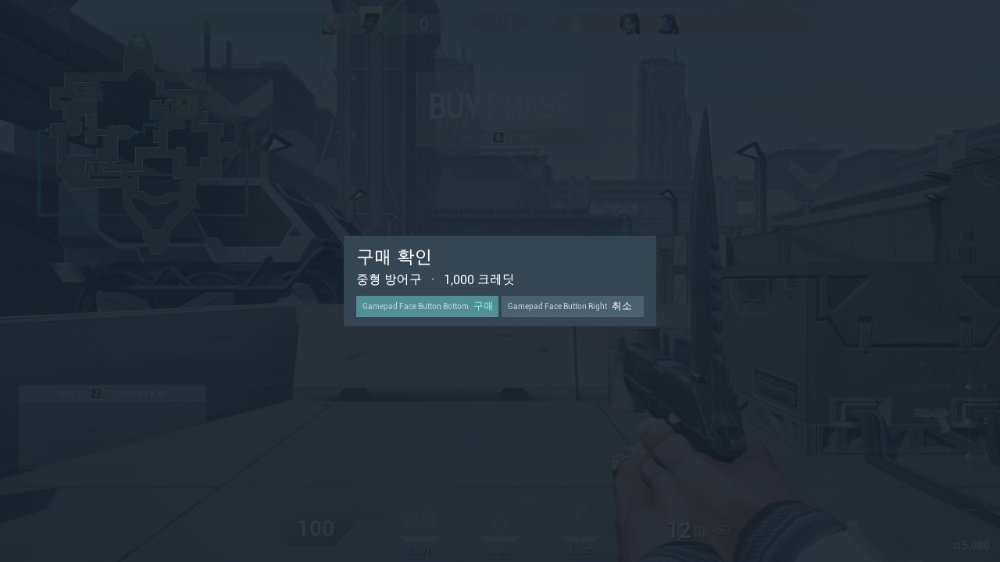
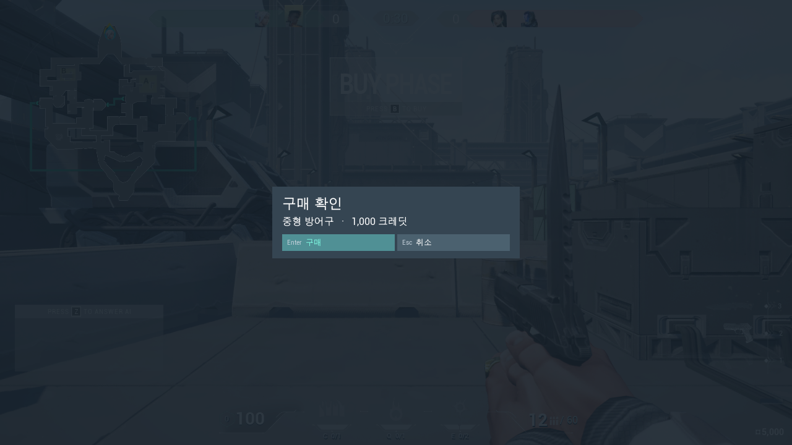

# Multiplayer UI Regression

## 환경과 재현

최신 결과의 제품·회귀 도구 기준은 입력 후속 개선 커밋 80a33a81이다. 이전 Release는 공개 main 0e2d734d에서 만든 로컬 커밋 35cda65d(제품)와 0d439057(회귀 도구)이었다. UE 5.5.4, Windows, Win64 Development Editor에서 실제 MatchMap의 호스트 1개와 원격 3개를 실행한다. 네 요원이 확정된 뒤 구매·장비·UI 검사를 시작한다.

프로젝트 폴더 UnrealEngine/Valorant에서 다음을 실행한다. EngineRoot에는 설치된 UE 5.5.4 폴더를 넣는다.

~~~powershell
$EngineRoot = 'C:/Program Files/Epic Games/UE_5.5'
& "$EngineRoot/Engine/Build/BatchFiles/Build.bat" ValorantEditor Win64 Development "-Project=$PWD/Valorant.uproject" -WaitMutex -NoHotReloadFromIDE
pwsh -File ./Tools/Run-UIRegression.ps1 -EngineRoot $EngineRoot -Port 18011 -TimeoutSeconds 210
~~~

PowerShell 7(pwsh)과 Windows PowerShell 5.1(powershell -File) 모두에서 실행한다. 5.1은 JSON 배열을 한 객체로 내보내므로 검사 목록을 @()로 다시 감싸지 않게 고쳤다. 최신 결과는 5.1로 실행했다.

에셋을 바꾼 뒤 첫 두 실행에서 DX12 원격의 게임 스레드가 수 분 멈췄다. 그동안 셰이더 컴파일 지연과 거리장 빌드 로그가 이어졌고, 캐시가 채워진 뒤에는 210초 안에 끝났다. 정확한 대기 지점은 디버거 없이 확인하지 못했다. 멈춘 원격의 연결이 끊기면 기존 UMiniMapWidget::UpdateAgentIcons가 다른 프로세스에서 크래시한다. 이 크래시는 이번 범위 밖이라 고치지 않았다.

호스트와 보조 클라이언트는 NullRHI, 화면 캡처용 원격 피닉스는 DX12 오프스크린이다. Steam과 HTTP를 실행 옵션으로 끄고 루프백에만 연결한다. 엔진 USD 플러그인 초기화 오류가 발생한 환경에서 게임과 무관한 USD 플러그인을 회귀 실행 옵션으로 비활성화했다. 일반 프로젝트 설정을 바꾸지는 않았다.

## 보호와 판정

WITH_DEV_AUTOMATION_TESTS 및 비 Shipping 빌드에서만 도구를 컴파일한다. UIRegressionReplay 실행 플래그와 루프백 연결을 함께 요구한다. 독립 시험 매치에서만 잔액·AttributeSet·장비를 바꾸고, 스크립트가 생성한 네 프로세스는 종료한다.

필수 ID와 프로세스는 UIRegressionChecks.json이 정의한다. 정상 완료는 모든 필수 검사가 지정한 프로세스에서 정확히 한 번 PASS이며 네 프로세스가 판정 전까지 살아 있는 상태다. 실패·조건 거부·검사 누락·중복·알 수 없는 ID·비정상 종료는 실패 종료한다. 결과 JSON의 NOT RUN은 해당 프로세스에서 검사 결과가 없다는 뜻이다.

새 판정기는 초기 USD 오류 실행을 실패 종료하고 49개를 NOT RUN으로 기록했다. 수정된 환경에서 전체 필수 항목을 다시 실행했다. 출하 스크립트의 실제 판정 조건에 중복 기록과 한 개 누락을 넣어 두 경우 모두 거부됨을 검사했다. 별도 일반 Listen 실행에서는 명시적 플래그 없이 상태 변경 명령을 거부했다. 이전 비공개 개발 버전의 46건은 이번 결과에 합산하지 않는다.

## 실패 주입과 비교값

- 생성 거부는 시험 동안 대상 UClass의 abstract 플래그를 설정하고 TGuardValue가 복원한다.
- 1인칭 부착 실패는 월드 무기 루트를 Static으로 만든다. 검사 후 원래 이동성과 물리 설정으로 돌려놓는다.
- 3인칭 생성 거부와 Static 루트의 부착 실패를 각각 실행한다. 콜백과 클래스 플래그는 같은 동기 범위에서 해제한다.
- 각 실패에서 기존 장비와 주인, 월드 무기의 Owner·Attach 부모·Transform·물리·충돌·Actor 수를 비교한다. 성공 재시도와 드롭도 이어서 확인한다.
- 보조 원격에서 실제 구매 결과의 ViewModel 전달을 보류해 10초 타이머를 발생시킨다. 서버의 실제 장비·잔액과 새 요청의 상태를 확인한다.
- 원격 화면의 잔액 텍스트, 포커스, 스킬 스택, 아머·탄약과 Actor 수는 복제 후 검사한다. AttributeSet과 GameState의 도착은 각각 기다린다.

## 최신 실행 결과

실제 실행의 요약과 모든 검사 상태는 [results.json](Evidence/results.json), 대표 서버·원격 로그는 [regression-results.txt](Evidence/regression-results.txt)에 있다. 실행 20261123-211159-774에서 52개 필수 검사가 각 지정 프로세스에서 한 번씩 PASS였다. 전체 C++ 빌드에 이어 커밋 80a33a81을 기록한 상태에서 실행했다. 이번에 바꾼 WBP_ShopConfirmation·WBP_ShopButton·PC_Agent·BP_UIInputData는 AgentMCP 컴파일 오류·경고 0개였다. 이전 Release의 49개 결과는 커밋 0d439057 기준이며 이번 결과와 합산하지 않는다.

후속 개선에서 바뀐 검사는 네 개다. SHOP.REQUEST.REENTRY는 새 서버 정책에 맞춰 SHOP.REQUEST.ORDER로 바꿨다. 이미 처리한 번호와 더 오래된 번호를 보내고, 오래된 번호의 요청이 새 번호였다면 승인됐을 손상 방어구 복구여도 잔액이 그대로인지 본다. UI.ACTION.SCREEN·UI.ACTION.MODAL은 CommonUI 라우터의 활성 바인딩에서 Back·상점 키·LB/RB와 모달 버튼의 Default Click·Back을 확인한다. UI.ACTION.PROMPTS는 입력 방식을 패드에서 키보드·마우스로 바꿀 때 모달의 키 표시가 바뀌는지 확인한다. 화면 코드에 키 판정이 없으므로 기존 LB·D-pad·A·B 주입 검사가 그대로 액션 경로를 지난다.

| 항목 | 기대 결과 |
| --- | --- |
| 구매·환불 | 서버 판정과 실제 슬롯·잔액이 일치하고 최대 방어구·스킬을 거부한다. |
| 월드 무기 | 실패 시 소유권·물리·충돌·기존 슬롯을 보존하고 재획득한다. |
| 표시 수명 | 교체·드롭·사망에서 종속 Actor가 누적되지 않는다. |
| 세션·응답 | 늦은 결과가 새 요청을 끝내지 않고, 타임아웃 뒤 실제 지급을 유지한다. |
| UI·입력 | Back·상점 키·LB/RB와 모달 확인·취소가 CommonUI 액션으로 동작하고, 입력 방식에 따라 키 표시가 바뀐다. 모달 취소 후 포커스가 돌아오며 메뉴 중 시작 입력과 누른 키 유출을 막는다. |
| HUD | 발사·재장전·스킬 소모·피격·킬 피드·HUD 재생성을 반영한다. |

## 필수 검사 목록

| ID | 프로세스 | 검사 내용 |
| --- | --- | --- |
| SHOP.ARMOR.DUPLICATE | host | armor: initial purchase and repeated full-tier rejection |
| SHOP.ARMOR.DAMAGED_UPGRADE | host | armor: damaged refill, full-price upgrade, damaged downgrade rejection |
| SHOP.ARMOR.INVALID | host | armor: insufficient credit and unknown ID preserve balance and armor |
| SHOP.REQUEST.ORDER | host | requests: a processed or older request number is rejected without settlement |
| WEAPON.PICKUP.FIRST_PERSON_FAILURE | host | world pickup: first-person attachment failure preserves the world weapon and previous slot |
| WEAPON.PICKUP.SPAWN_FAILURE | host | world pickup: presentation spawn failure restores transform physics collision and ownership |
| WEAPON.PICKUP.ATTACH_FAILURE | host | world pickup: presentation attachment failure leaves no dependent actor and permits retry |
| SHOP.WEAPON.REFUND | host | weapons: new slot ownership, unused replacement refund, duplicate request |
| SHOP.WEAPON.SPAWN_FAILURE | host | weapons: engine rejects a deferred spawn and preserves the old slot and balance |
| SHOP.WEAPON.ATTACH_FAILURE | host | weapons: failed presentation attachment preserves the old slot and balance |
| WEAPON.PICKUP.RETRY | host | weapons: used gun drops, can be picked up, and presentation count stays bounded |
| SHOP.REQUEST.PENDING_CLICK | client2 | timeout fixture sends one purchase and blocks a second click |
| SHOP.REQUEST.TIMEOUT | client2 | timeout clears UI pending while real weapon and debit replicate |
| SHOP.REQUEST.STALE_REPLY | client2 | held success cannot complete the new request |
| SHOP.REQUEST.AFTER_TIMEOUT | client2 | new response completes once and preserves both server purchases |
| UI.INPUT.FIRE_RELEASE | client2 | opening during held fire stops the shot sequence |
| WEAPON.LIFETIME.DEATH | host | death removes all captured presentation actors while sidearm stays in the world |
| HUD.KILL_FEED | host | GAS kill creates a Blueprint kill-feed card on the host |
| UI.FOCUS.INITIAL | client1 | initial Classic focus |
| UI.ACTION.SCREEN | client1 | shop screen binds Back, shop key and LB/RB as CommonUI actions |
| HUD.CARDS.INITIAL | client1 | buy phase has four top HUD cards |
| UI.INPUT.CROUCH_WALK_RELEASE | client1 | opening while crouched and walking releases both states |
| UI.FOCUS.CATEGORY | client1 | armor category focuses Light Shield |
| UI.FOCUS.DPAD | client1 | D-pad skips Regen and focuses Heavy Shield |
| UI.MODAL.ARMOR | client1 | Heavy Shield maps to item 2 and opens modal |
| UI.ACTION.MODAL | client1 | modal buttons own the default Click and Back actions while LB/RB are inactive |
| UI.ACTION.PROMPTS | client1 | modal key prompts follow the switch between gamepad and keyboard |
| UI.MODAL.CANCEL | client1 | cancel restores the Heavy Shield button |
| SHOP.REQUEST.PENDING | client1 | confirm emits a pending remote purchase |
| SHOP.SESSION.REOPEN_PENDING | client1 | screen reopen preserves pending and ignores uncorrelated legacy reply |
| SHOP.SESSION.LATE_REPLY | client1 | late Heavy Shield reply updates replication, model and UI without restoring old feedback |
| SHOP.SESSION.DUPLICATE_REPLY | client1 | duplicate response leaves the reopened shop unchanged |
| SHOP.ARMOR.CLIENT_DUPLICATE | client1 | full Heavy Shield cannot open a second modal |
| UI.FOCUS.WEAPON | client1 | weapon navigation focuses Shorty |
| UI.MODAL.WEAPON | client1 | Shorty opens weapon confirmation |
| SHOP.WEAPON.REPLICATION | client1 | weapon purchase replicates slot and balance to the remote owner |
| WEAPON.LIFETIME.REPLACEMENT | client1 | remote unused replacement keeps counts and initializes the replicated mesh |
| UI.FOCUS.SKILL | client1 | skill category focuses the authored Phoenix C button |
| UI.MODAL.SKILL | client1 | Phoenix C authored button sends the current agent skill ID |
| SHOP.SKILL.REPLICATION | client1 | Phoenix C purchase replicates into HUD and debits 300 |
| UI.INPUT.INJECT | client1 | Enhanced Input action injection started while shop is open |
| UI.INPUT.BLOCK | client1 | open shop blocks movement, aim, fire, skill and weapon switch |
| UI.INPUT.AUTO_CLOSE | client1 | round start clears shop stack |
| HUD.CARDS.ROUND | client1 | round transition preserves exactly four top HUD cards |
| UI.INPUT.HELD_KEYS | client1 | held shop keys do not carry movement or fire into gameplay |
| UI.INPUT.RESTORE | client1 | gameplay input restored after closing |
| HUD.REPLICATION.AMMO | client1 | remote release and reload propagate ammo |
| HUD.SKILL.FOLLOW_UP | client1 | Phoenix preparation shows existing follow-up hint |
| HUD.SKILL.CONSUME | client1 | Phoenix confirmed ability consumes stack and refreshes HUD |
| HUD.REPLICATION.VITALS_SCORE | client1 | server health and score change reach remote HUD |
| HUD.RECREATE | client1 | two HUD recreations restore vitals and keep four cards |
| HUD.DAMAGE_INDICATOR | client1 | GAS damage creates a Blueprint damage indicator |

## 실행하지 않은 조건

실물 Xbox·PlayStation 컨트롤러, 물리 키보드·마우스 혼용, Win64 패키지, Steam·전용 서버, 실제 네트워크 지연·손실, 독립 PlayerState·ASC 교체와 ServerTravel은 NOT RUN이다. 입력 주입 결과는 로컬 재현 범위다.

입력 후속 개선의 NOT RUN 범위는 다음과 같다. 키 표시 전환은 UCommonInputSubsystem::SetCurrentInputType으로 입력 방식을 바꿔 확인했고 실제 키보드·마우스 이벤트로 전환하지 않았다. Enter·Esc·B(상점 키)·View 키 입력은 주입하지 않았다. 같은 액션 행의 패드 키(A·B·LB·RB)만 주입했다. 아이콘 에셋이 없어 아이콘 표시는 확인하지 않았고 키 이름 텍스트를 확인했다. 패키지 빌드에서 Input Data·DataTable이 쿡되는지는 확인하지 않았다. 방향별 피격 표시와 모든 총기 애니메이션은 별도 확인이 필요하며, 기존 쇼티 데이터에는 발사 애니메이션이 빠져 있다.

새 일반 획득 실패 주입은 호스트에서 수행했다. 원격에서는 정상 교체 후 소유권·슬롯·메시·Actor 수와 HUD를 확인했다. 소스 전용 미러는 필수 WBP와 MatchMap을 포함하지 않으므로 원본 VALORANT 프로젝트에서 전체 검증을 실행해야 한다.
